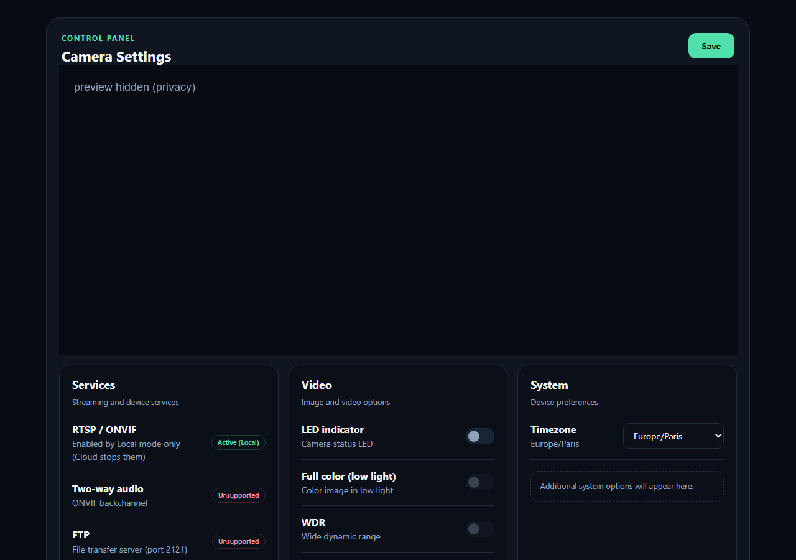
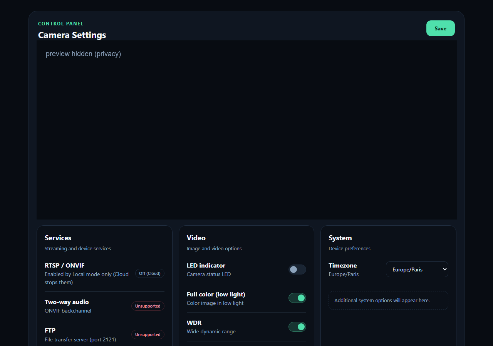

# Web UI and CGI API

`http://<camera-ip>:8080/` is served by busybox `httpd` from `/mnt/sdcard/hacks/www`
([`webui/`](../webui/)). The page is a single HTML file with plain JavaScript; all actions are
CGI shell scripts. There is no authentication. Defects are listed in
[known-issues.md](known-issues.md). Validation status per endpoint: [validation.md](validation.md).

| Local mode | Cloud mode |
|---|---|
|  |  |

## Page behaviour

- On load: `status`, `props`, `tz`, `files`, snapshot metadata. No motor command is sent on load.
- Polling: `status` every 10 s, `props` every 20 s, snapshot metadata every 30 s (the image is
  reloaded only when its mtime changes).
- Requests sent through `jget`/`jfetch` have a timeout and are retried once after 0.9 s on any
  failure, including timeouts; they carry a `_=<timestamp>` cache-busting parameter and use
  `cache: 'no-store'`. The snapshot metadata refresh and the file upload use plain `fetch`
  without timeout or retry.
- Sections: preview (last snapshot, VLC link to `rtsp://<camera-ip>:8554/mainstream`), services
  (RTSP state, two-way audio and FTP shown as unsupported, PTZ switch, ONVIF option in Local mode,
  NAS option in Cloud mode), video (LED, full color, WDR, watermark, rotate 180°, night vision,
  FPS fixed and disabled), timezone, PTZ pad and calibration, mode selector with service badges
  and uptime/load/RAM, restart, file manager.
- The video settings other than LED are disabled when `props` fails (Local mode).

## Endpoints

All endpoints accept `GET` (`upload` uses the `POST` body). Parameters are read from the query
string with `sed` patterns; values outside the listed character sets are cut at the first
non-matching character. Responses are JSON unless noted. Only `status`, `cloud`, `opt` and
`snapshot` send `Cache-Control: no-store`.

| Endpoint | Parameters | Action | Response |
|---|---|---|---|
| `status` | none | read uptime, load, RAM %, listening ports from `/proc/net/tcp` (8554, 5000, 22), processes, prefs, timezone | `uptime`, `load`, `mem`, `services{rtsp,onvif,ssh}`, `ssh_avail`, `mode` (`cloud`/`local`/`mixed`/`off`), `cloud`, `nas`, `onvif_pref`, `nas_pref`, `ptz`, `tz` |
| `props` | none | `miio_rpc get_prop` of `watermark,wdr,light,flip,full_color,night_mode`; requires `miio_client` | `ok` and the six values, or `ok:false` with `error` |
| `setprop` | `name` = `watermark`/`wdr`/`flip`/`full_color`/`night_mode`, `value` = `on`/`off` or `0`/`1`/`2` | `miio_rpc set_<name>`, then reads the property back | `{"ok":true,"name","value"}` or `ok:false` |
| `led` | `state=on\|off` | writes GPIO 78; any other value only reads it | `{"ok":true,"led":"on\|off\|unknown"}` |
| `ptz` | `dir=up\|down\|left\|right\|stop`, `steps` (default 20, max 100) | runs `control ptz` with inverted axes, then `ptz get`; refused if `ptz_enabled` is `off` | `dir`, `move`, `steps`, `pos` |
| `ptztoggle` | `state=on\|off` | writes `ptz_enabled`, restarts `onvif-server` (which starts it in any mode) | `{"ok":true,"ptz"}` |
| `calibrate` | none | starts `control ptz calibrate` in the background; refused if PTZ is off | `{"ok":true,"msg"}` |
| `cloud` | `mode=local\|cloud` | full mode switch and persists `mode` (see [architecture.md](architecture.md#modes)); `off` is not accepted | `mode`, `rtsp`, `cloud` |
| `opt` | `name=onvif\|nas`, `state=on\|off` | persists the preference; applies it only if the current stored mode matches | `name`, `state`, `actual`, `mode` |
| `svc` | `name=rtsp\|onvif`, `action=up\|down` (anything else counts as `down`) | `rtsp up`: stop cloud services, store `local`, start framegrabber, RTSP and ONVIF. `rtsp down`: stop the three, store `off`. `onvif up/down`: start/stop ONVIF only. Not used by the page | `name`, `action`, `status` |
| `tz` | `set=<zone>` (optional) | with a valid zone file: symlink `/mnt/data/etc/TZ`; otherwise list | set: `{"ok":true,"current"}`; list: `{"current","zones":[...]}` (up to 8 fixed zones, only those present on the rootfs) |
| `files` | none | list the top level of `/mnt/sdcard/MIJIA_RECORD_VIDEO` | array of `{n,s,d,p}` (name, size, is-directory, path relative to `/mnt/sdcard`) |
| `download` | `path` (relative to `/mnt/sdcard`, `%2F` and `%20` decoded) | sends the file; rejects paths containing `..` or starting with `/` | file as `application/octet-stream`, or `forbidden` / `not found` as text |
| `upload` | `name` (`%20` decoded, `%2F` and `..` replaced by `_`), body | writes the body to `/mnt/sdcard/uploads/<name>` (default `upload.bin`) | `{"ok":true,"name","size"}` |
| `snapshot` | `info=1` (optional) | `/mnt/sdcard/MIJIA_RECORD_VIDEO/tmp.jpeg` | with `info=1`: `{"ok","size","mtime","path"}`; otherwise the JPEG, or a text message |
| `restart` | none | `sync; reboot` after 1 s | `{"ok":true,"msg"}` |

All paths are under `/cgi-bin/`.

## Other interfaces

| Service | Address | Credentials |
|---|---|---|
| RTSP | `rtsp://<camera-ip>:8554/mainstream` (Local mode) | none |
| ONVIF | `http://<camera-ip>:5000/` (Local mode, if enabled) | `admin` / `admin` |
| Telnet | `<camera-ip>:23` | root, no password |
| SSH (dropbear, optional) | `<camera-ip>:22` | from `config/ssh-server/config.json` |
| MiIO | UDP 54321 (Cloud mode) | device token |
